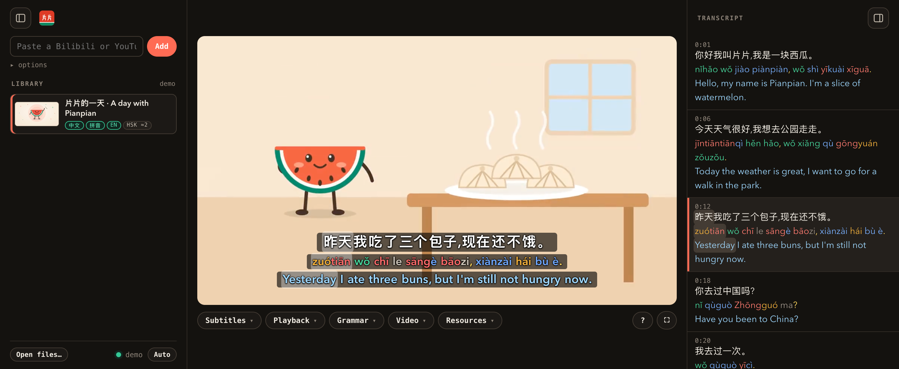
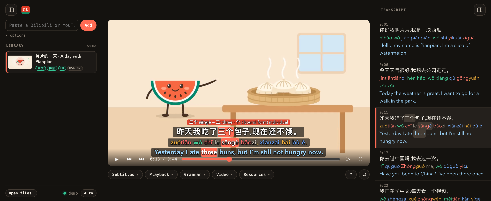
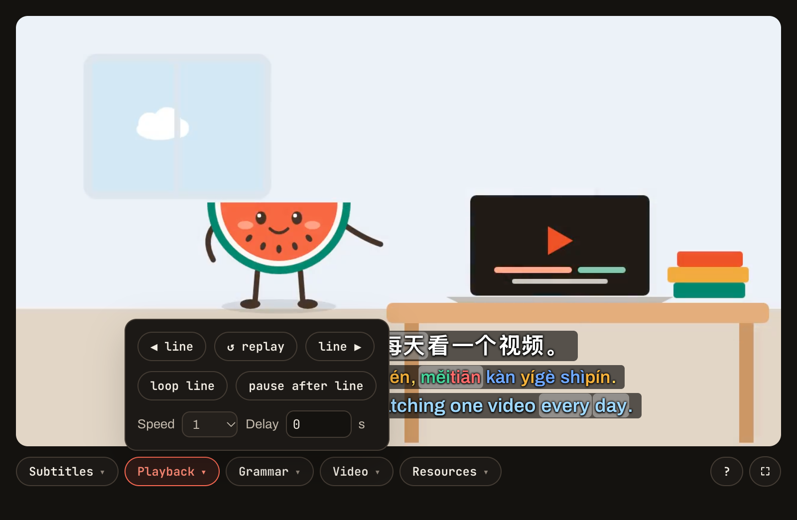
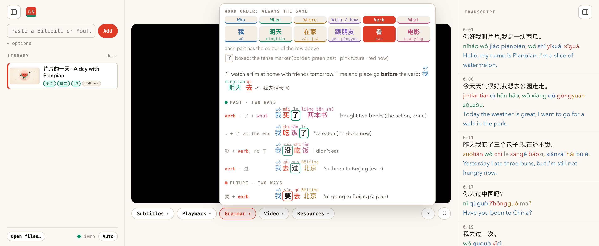

<div align="center">


# Pianpian 片片

**Learn Mandarin from the videos you actually watch.**<br>
Chinese, pinyin and English subtitles for any Bilibili or YouTube video, made on your Mac. Hover any word, practise line by line.

[](https://github.com/conradomateu/pianpian/actions/workflows/ci.yml)
[](https://github.com/conradomateu/pianpian/releases/latest)
[](https://github.com/conradomateu/pianpian/releases)
[](#install)
[](pyproject.toml)
[](LICENSE)

[**Download for Mac**](https://github.com/conradomateu/pianpian/releases/latest) · [**Try it in your browser**](https://conradomateu.github.io/pianpian/) · [What's new](https://github.com/conradomateu/pianpian/releases)



</div>

## Why

Real videos are the best way to learn a language, but Chinese subtitles alone are a wall of characters,
and English ones teach you nothing. Pianpian puts the three lines together and links them: hover 三个 and
you see sāngè, its meaning, its HSK level, and "three" lights up in the English. Everything runs on
your Mac with local models: no account, no API key, nothing uploaded.

The name is 片片 (piànpiàn), "piece by piece". The motto is 一天一片: one slice a day.

## What it does

| | |
|---|---|
|  | **Every word.** Hover a word for its pinyin, a dictionary meaning, its HSK level and its measure words. The same word lights up in the pinyin and in the English, so you see which part of the translation it is. |
|  | **Practise line by line.** <kbd>←</kbd> <kbd>→</kbd> jump between lines, <kbd>R</kbd> replays, <kbd>L</kbd> loops, <kbd>P</kbd> pauses after every line so you can say it yourself, and the speed goes down to half. Click any line in the transcript to jump there. |
|  | **See how a sentence is built.** A cheat sheet for word order, every part in its own colour with pinyin above, and optional marks under 了, 过, 在 and 要 that say past, now or later. |

And also:

- **Any video:** Bilibili, YouTube and most video sites, or a file you drop on the window. It uses the platform's subtitles when there are some; otherwise Whisper hears the Chinese, and burned-in subtitles are read with macOS's own text recognition.
- **Tone colours** on the pinyin, which can also sit right above each character.
- **Follow the voice:** the word being said lights up as it is spoken.
- **Your level:** each video in your library shows the HSK level that covers 90% of its words.
- **Yours to keep:** every video is also saved as one MKV with all the subtitle tracks, for IINA, VLC or mpv.

## Install

1. Download **Pianpian-macOS.dmg** from the [latest release](https://github.com/conradomateu/pianpian/releases/latest), open it and drag **Pianpian** onto the Applications folder in the window.
2. Open it. Pianpian isn't signed with a paid Apple developer certificate yet, so the first time macOS says it can't check it: go to **System Settings → Privacy & Security** and press **Open Anyway**.
3. The first start asks where to keep your videos and its tools, then downloads them once, with progress: its engine (about 650 MB) and the speech and translation models (1.6 GB and 1 GB). From mainland China it picks faster mirrors by itself.

**Needs** a Mac with Apple Silicon (M1 or newer), macOS 14 Sonoma or newer, and about 4 GB of disk.
Updates: the app tells you when a new version is out, and keeps its video downloader fresh on its own.

## Use

1. Paste a Bilibili or YouTube link (or the text a *Share* button copies: the link inside is found, and tracking is removed) and press **Add** (or drop a video file on the window). For Bilibili's own AI subtitles, pick the browser you're logged in with under *options*.
2. A ten-minute video is ready in about a minute. It opens by itself.
3. Hover, click, loop. Menus under the video: **Subtitles**, **Playback**, **Grammar**, **Video**, **Resources**. Keys: <kbd>B</kbd> library, <kbd>T</kbd> transcript, <kbd>?</kbd> all shortcuts.

Lines too long? **Video ▾ → Lines** cuts them again from Whisper's word timings. A wrong pinyin? Add the word to [`pipeline/pinyin_fixes.txt`](pipeline/pinyin_fixes.txt) and press **Video ▾ → Rebuild**.

Something went wrong? The app says what in plain words; **Report** opens a GitHub issue already filled in with details that leave out your files and links. Nothing is sent until you press Submit.

## How it works

```
link or file ─► yt-dlp ─► Chinese: the platform's subtitles, Whisper (MLX) or macOS OCR
                          ─► pinyin and words: jieba, pypinyin, CC-CEDICT, HSK 3.0 levels
                          ─► English: Tencent's Hy-MT2 (MLX), line by line, then word links
                          ─► the player, and study.mkv
```

The app is a small local server (Python standard library) and one page, in a native window. The pipeline
runs in its own environment with pinned packages and pinned models. More in [ARCHITECTURE.md](ARCHITECTURE.md).

## Development

```bash
git clone https://github.com/conradomateu/pianpian && cd pianpian
python3 dev.py engine     # the pipeline's environment in .venv (uv; no torch, about 700 MB)
python3 dev.py serve      # the app in your browser at http://127.0.0.1:8770
python3 dev.py check      # lint and tests, the same as CI
```

| Command | Does |
|---|---|
| `python3 dev.py app` | A dev `Pianpian.app` in `~/Applications` that runs this checkout |
| `python3 dev.py build` | The real `dist/Pianpian.app` and its zip, as releases ship it |
| `python3 dev.py preview` | The website with the live demo, at http://127.0.0.1:8765 |
| `python3 dev.py shots` | The screenshots above, taken from the demo |
| `python3 dev.py lock` | Pin the engine's packages and the models again |
| `python3 dev.py version` | Preview the next release: its version, and which commits decide it |

From mainland China, set `UV_DEFAULT_INDEX=https://pypi.tuna.tsinghua.edu.cn/simple` first.
Commit messages and pull request titles start with `feat:`, `fix:`, `docs:` or `chore:`: release-please
writes the changelog and the version from them, and each release builds the app. `fix:` makes a patch
release (0.1.0 → 0.1.1), `feat:` a minor one (0.2.0), `feat!:` a major one (a minor while we are on 0.x), and
`docs:`/`chore:` none. `python3 dev.py version` shows what the commits so far would make; a line
`Release-As: 0.1.1` at the end of a commit message forces the number.

## Licence and credits

Pianpian is [MIT licensed](LICENSE). The name and the watermelon logo are not part of the licence:
if you make your own version, give it another name.

It stands on other people's work, used under their terms:

- **Models**, downloaded on first run, not shipped: [Whisper large-v3-turbo](https://huggingface.co/openai/whisper-large-v3-turbo) by OpenAI (MIT) and [Hy-MT2-1.8B](https://huggingface.co/Tencent-Hunyuan/Hy-MT2-1.8B) by Tencent (Apache-2.0), in the MLX builds by [mlx-community](https://huggingface.co/mlx-community).
- **CC-CEDICT** meanings (CC BY-SA 4.0), downloaded on first run, not shipped.
- **HSK 3.0 word levels** from [complete-hsk-vocabulary](https://github.com/drkameleon/complete-hsk-vocabulary) (MIT, [`hsk3.LICENSE`](pipeline/data/hsk3.LICENSE)).
- **The demo** is made from scratch: the script, the drawings and the music are in [`tools/demo/`](tools/demo), and the voice is [Kokoro-82M](https://huggingface.co/hexgrad/Kokoro-82M) (Apache-2.0).
- [yt-dlp](https://github.com/yt-dlp/yt-dlp), [jieba](https://github.com/fxsjy/jieba), [pypinyin](https://github.com/mozillazg/python-pinyin), [MLX](https://github.com/ml-explore/mlx), [pywebview](https://github.com/r0x0r/pywebview) and [uv](https://github.com/astral-sh/uv).

Only download videos you are allowed to watch, and don't re-upload them.
