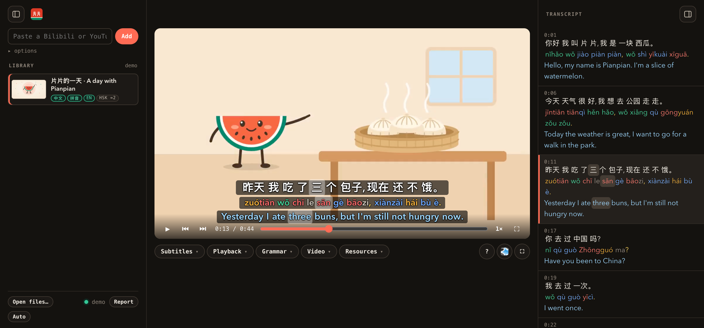
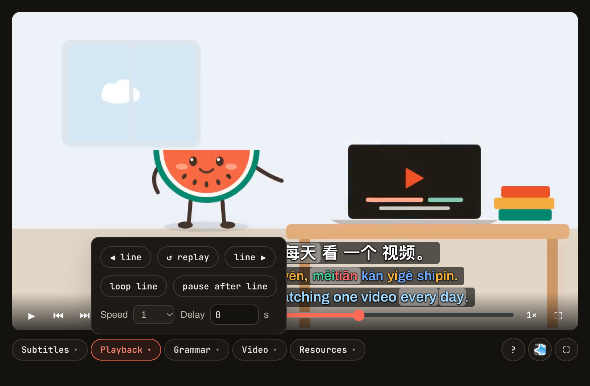
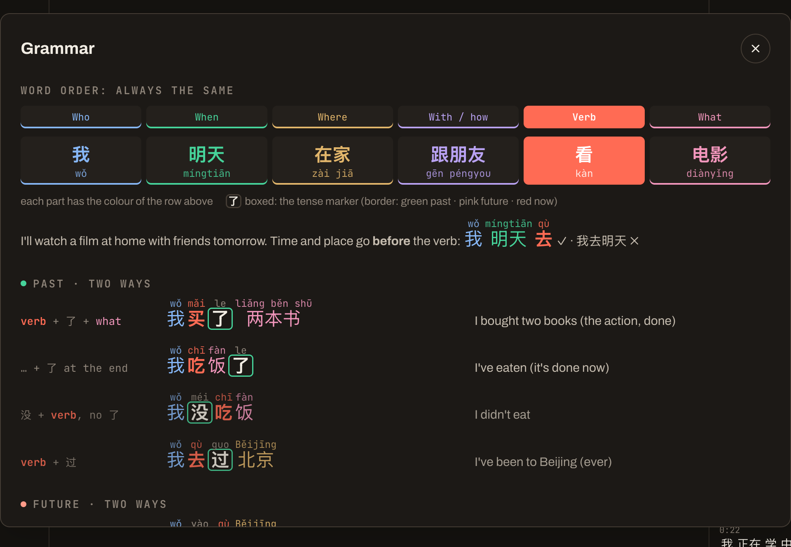

# Pianpian 片片

**Learn Chinese from the videos you love.** 
Chinese, pinyin and English subtitles for Bilibili, YouTube and your own videos, made on your computer. Click a word, practise line by line.

[**Download for Mac or Windows**](https://pianpian.app/) · [**Try the browser demo**](https://pianpian.app/#demo) · [Release notes](https://github.com/conradomateu/pianpian/releases)

## Why

Pianpian links Chinese, pinyin and English: click a word for its pronunciation, meaning and HSK level, with matching English highlighted where a word link is available. Speech recognition and translation run locally: no account or model API key, and your videos aren't uploaded.

The name is 片片 (piànpiàn), "piece by piece". The motto is 一天一片: one slice a day.

## What it does

| | |
|---|---|
|  | **Word lookup.** Hover or click a word for its pinyin, dictionary meanings, HSK level and measure words where available. Matching pinyin and linked English light up together. |
|  | **Practise line by line.** <kbd>←</kbd> <kbd>→</kbd> jump between lines, <kbd>R</kbd> replays, <kbd>L</kbd> loops, <kbd>P</kbd> pauses after every line so you can say it yourself, and playback speed goes down to 0.5×. Click any line in the transcript to jump there. |
|  | **See how a sentence is built.** A cheat sheet for word order, every part in its own colour with pinyin above, and optional marks under 了, 过, 在 and 要 that say past, now or later. |

- **Links or files:** Bilibili, YouTube and other sites supported by yt-dlp, or a video you drop on the window. It uses available Chinese subtitle tracks or SenseVoice speech recognition. Text burned into the video image is not extracted.
- **Tone colours** on the pinyin, which can also sit right above each character.
- **Follow the voice:** the word being said lights up as it is spoken.
- **Your level:** each video in your library shows the HSK level that covers 90% of its words.
- **Yours to keep:** every video is also saved as one MKV with all the subtitle tracks, for IINA, VLC or mpv.

## Install

### macOS

1. Download **Pianpian-macOS.dmg** from the [latest release](https://github.com/conradomateu/pianpian/releases/latest), open the DMG and drag **Pianpian** onto the Applications folder in the window.
2. Open Pianpian. Pianpian isn't signed with a paid Apple developer certificate yet, so the first time macOS says it can't check it: go to **System Settings → Privacy & Security** and press **Open Anyway**.
3. Choose where to keep videos and tools, then let setup download the selected models.

**Needs** Apple Silicon (M1 or newer) and macOS 14 Sonoma or newer. Translation uses Apple Metal by default.

### Windows

1. Download **Pianpian-Windows-Setup.exe** from the [latest release](https://github.com/conradomateu/pianpian/releases/latest) and run the installer. Installation is per user (no admin) into `%LOCALAPPDATA%\Programs\Pianpian`. If SmartScreen warns about the unsigned installer: **More info → Run anyway**.
2. Choose where to keep videos and tools, then let setup download the selected models.

**Needs** Windows x64 and [WebView2](https://developer.microsoft.com/microsoft-edge/webview2/). Windows 11 is recommended; Windows 10 is allowed but untested. Windows ARM64 and 32-bit Windows are unsupported. Installation does not require administrator access, and the app includes its Microsoft C++ runtime libraries.

**CPU is the default**, even on NVIDIA computers. SenseVoice selects AVX2 when supported. CUDA/Vulkan acceleration is optional for translation; detecting a GPU does not select or download it. No CUDA Toolkit is needed. [Acceleration options and costs](ARCHITECTURE.md#compact-installation-accounting).

**Test status, 16 Nov 2026:** the packaged CPU pipeline passes Windows CI. Interactive installation and upgrades on a Windows desktop still need testing. [Evidence and remaining checks](ARCHITECTURE.md#windows-test-history).

### First-run downloads and updates

Both platforms use **SenseVoice Q8 + its speech detector (256 MB)** and **PLaMo Q3_K_M (486 MB)**: **742 MB of models**. Speech and bilingual word links run on CPU.

| Download | Mac | Windows, CPU default |
|---|---:|---:|
| Model weights | 742 MB | 742 MB |
| Translation runtime | 16 MB | 24 MB |
| Five Python packages, compressed | about 45 MB | about 55 MB |
| **Subtotal** | **about 803 MB** | **about 821 MB** |

**Python itself, the dictionary and the app installer are additional downloads.** Installed and temporary unpacking space are separate; allow space for your videos too. Setup shows the selected downloads and tries alternative sources. [Exact component sizes](ARCHITECTURE.md#compact-installation-accounting).

The app announces new versions and updates its video downloader separately. Upgrading from Hy-MT2 switches translation to PLaMo and downloads missing weights; saved videos and subtitles stay available. For source checkouts, see [Updating a checkout](CONTRIBUTING.md#updating-a-checkout).

## Use

1. Paste a Bilibili or YouTube link or the text from a *Share* button; Pianpian finds the link and removes tracking. Press **Add** or drop a video file on the window. For Bilibili's own AI subtitles, pick the browser you're logged in with under *options*.
2. Wait for processing; the video opens when ready. Processing time depends on the video, hardware and downloads.
3. Hover over or click words, and loop subtitle lines. Menus under the video: **Subtitles**, **Playback**, **Grammar**, **Video**, **Resources**, **Anki**. Keys: <kbd>B</kbd> library, <kbd>T</kbd> transcript, <kbd>?</kbd> all shortcuts.

Subtitle lines too long? **Video ▾ → Lines** cuts them again from the speech recognizer's word timings. Wrong pinyin for a word? Add the word to [`pipeline/pinyin_fixes.txt`](pipeline/pinyin_fixes.txt) and press **Video ▾ → Rebuild**.

Something went wrong? Pianpian explains the problem; **Report** opens GitHub's issue form with redacted details. Opening the issue form sends those details to GitHub; pressing Submit publishes the issue.

Videos default to `~/Movies/Pianpian` on macOS or `%USERPROFILE%\Videos\Pianpian` on Windows. Setup can change the tools and data folder and move its downloads; choosing a different library folder does not move existing videos. [Storage and cleanup](ARCHITECTURE.md#first-run-updates-and-problems).

### Send a selection to Anki

1. Open Anki Desktop, install [AnkiConnect](https://ankiweb.net/shared/info/2055492159) with add-on code **2055492159**, then restart Anki Desktop and open your profile.
2. In a processed video, click a Chinese word; **Shift+click** selects a range. Open the **Anki** editor from the dictionary card or toolbar; **Use full sentence** selects the current sentence.
3. Press **Listen** to hear the original audio. **Adjust audio** changes the start/end, restores the sentence audio and sets the margins.
4. Choose an existing or new deck, then **Add to Anki**. The note includes Chinese, pinyin, meaning, sentence, translation, audio and source title.

Exporting the same selection from the same video again offers **Update existing note**, preserving the note's cards, review history, tags and deck. When moving a video's folder, keep its `.pianpian-source-id` file inside so Pianpian recognizes previous exports.

**Edit text & color** changes the note fields, tone colours and highlight. If Anki Desktop is unavailable, the open draft stays in place for **Retry connection**. **Connection settings** accepts a local port and optional AnkiConnect API key (default port: 8765).

Word times are estimates: preview and listen before saving; missing or invalid times use sentence bounds. Export requires the local Pianpian app and its local server. Anki export has not been tested on Windows.

## Development

[CONTRIBUTING.md](CONTRIBUTING.md#set-up) has the prerequisites, setup commands and checks for Mac and Windows. Downloaded apps include the native helpers; source builds require CMake and a C++17 compiler.

[ARCHITECTURE.md](ARCHITECTURE.md) describes the pipeline, APIs, packaging and test scope. Model inference runs locally; Python orchestrates it using five packages.

## Contributing

Fixes, pinyin corrections and ideas are welcome: [CONTRIBUTING.md](CONTRIBUTING.md) says how to start, what a pull request needs and what you agree to when you send one (your code goes in under the MIT licence).
Security problems: [SECURITY.md](SECURITY.md).

## Licence and credits

Pianpian is [MIT licensed](LICENSE). The name and the watermelon logo are not part of the licence:
if you make your own version, give it another name.

Pianpian stands on other people's work, used under their terms:

- **Models**, downloaded on first run, not shipped: [SenseVoiceSmall GGUF](https://huggingface.co/FunAudioLLM/SenseVoiceSmall-GGUF) and [FSMN-VAD GGUF](https://huggingface.co/FunAudioLLM/fsmn-vad-GGUF) by FunAudioLLM (Apache-2.0), and [PLaMo 3 Translate 0.8B GGUF](https://huggingface.co/pfnet/plamo-3-translate-0.8b-GGUF) by Preferred Networks, under the [PLaMo Community License](https://huggingface.co/pfnet/plamo-3-translate-0.8b-GGUF#license). Consult that license for commercial-use terms.
- **Native speech runtime:** pinned [FunASR](https://github.com/modelscope/FunASR) and [llama.cpp](https://github.com/ggml-org/llama.cpp) source with Pianpian's timing adapter. Their notices and included third-party licences ship beside the helper in `pipeline/bin/sensevoice-NOTICES.txt`.
- **CC-CEDICT** meanings (CC BY-SA 4.0), downloaded on first run, not shipped.
- **HSK 3.0 word levels** from [complete-hsk-vocabulary](https://github.com/drkameleon/complete-hsk-vocabulary) (MIT, [`hsk3.LICENSE`](pipeline/data/hsk3.LICENSE)).
- **The demo** is made from scratch: the script, the drawings and the music are in [`tools/demo/`](tools/demo), and the voice is [Kokoro-82M](https://huggingface.co/hexgrad/Kokoro-82M) (Apache-2.0).
- **Anki logo** © Alex Fraser, used unmodified under its [limited alternative licence](assets/anki-logo-license.txt).
- [yt-dlp](https://github.com/yt-dlp/yt-dlp), [jieba](https://github.com/fxsjy/jieba), [pypinyin](https://github.com/mozillazg/python-pinyin), [llama.cpp](https://github.com/ggml-org/llama.cpp), [pywebview](https://github.com/r0x0r/pywebview) and [uv](https://github.com/astral-sh/uv).

Only download videos you are allowed to watch, and don't re-upload them.

[Code signing policy](CODE_SIGNING.md) · [Windows signing setup](docs/windows-signing.md)
