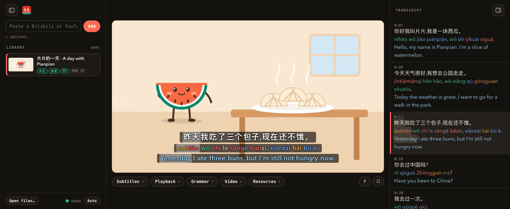
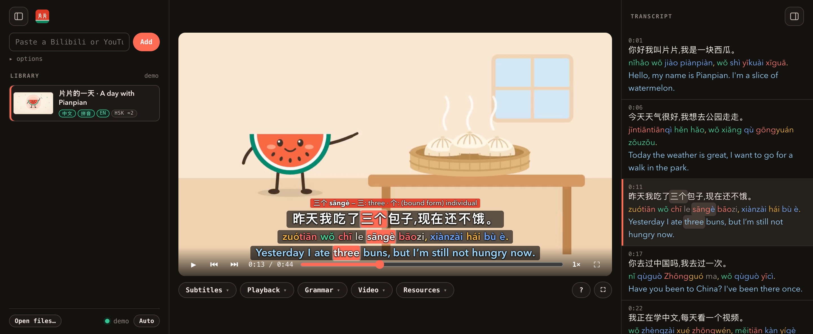
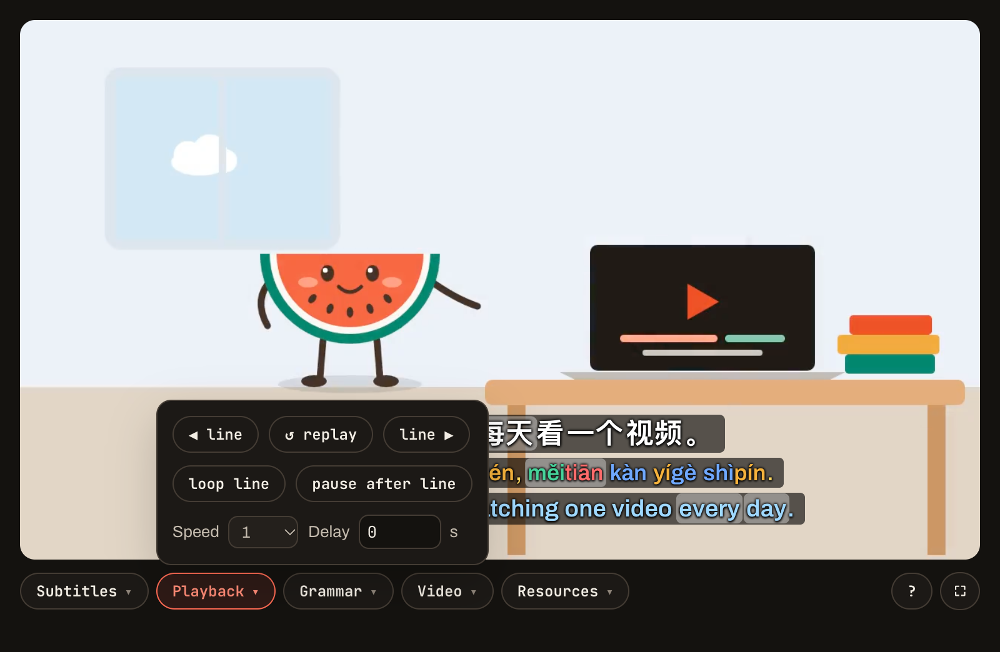
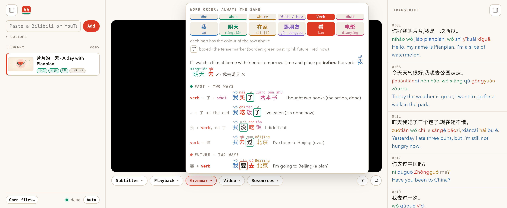

<div align="center">


# Pianpian 片片

**Learn Mandarin from the videos you actually watch.**<br>
Chinese, pinyin and English subtitles for Bilibili, YouTube and your own videos, made on your computer. Click a word, practise line by line.

[](https://github.com/conradomateu/pianpian/actions/workflows/ci.yml)
[](https://github.com/conradomateu/pianpian/releases/latest)
[](#install)
[](#install)
[](LICENSE)

[**Download for Mac or Windows**](https://pianpian.app/) · [**Try it in your browser**](https://pianpian.app/#demo) · [What's new](https://github.com/conradomateu/pianpian/releases)



</div>

## Why

Pianpian links Chinese, pinyin and English: click a word for its pronunciation, meaning and HSK level, with matching English highlighted where a word link is available. Speech recognition and translation run locally: no account or model API key, and your videos aren't uploaded.

The name is 片片 (piànpiàn), "piece by piece". The motto is 一天一片: one slice a day.

## What it does

| | |
|---|---|
|  | **Word lookup.** Hover or click a word for its pinyin, dictionary meanings, HSK level and measure words where available. Matching pinyin and linked English light up together. |
|  | **Practise line by line.** <kbd>←</kbd> <kbd>→</kbd> jump between lines, <kbd>R</kbd> replays, <kbd>L</kbd> loops, <kbd>P</kbd> pauses after every line so you can say it yourself, and the speed goes down to half. Click any line in the transcript to jump there. |
|  | **See how a sentence is built.** A cheat sheet for word order, every part in its own colour with pinyin above, and optional marks under 了, 过, 在 and 要 that say past, now or later. |

- **Links or files:** Bilibili, YouTube and other sites supported by yt-dlp, or a video you drop on the window. It uses available Chinese subtitles, Whisper speech recognition or OCR for burned-in subtitles (macOS Vision; Windows RapidOCR remains untested as of 7 Nov 2026).
- **Tone colours** on the pinyin, which can also sit right above each character.
- **Follow the voice:** the word being said lights up as it is spoken.
- **Your level:** each video in your library shows the HSK level that covers 90% of its words.
- **Yours to keep:** every video is also saved as one MKV with all the subtitle tracks, for IINA, VLC or mpv.

## Install

### macOS

1. Download **Pianpian-macOS.dmg** from the [latest release](https://github.com/conradomateu/pianpian/releases/latest), open it and drag **Pianpian** onto the Applications folder in the window.
2. Open it. Pianpian isn't signed with a paid Apple developer certificate yet, so the first time macOS says it can't check it: go to **System Settings → Privacy & Security** and press **Open Anyway**.
3. The first start asks where to keep your videos and its tools, then downloads them once, with progress: its engine (about 650 MB) and the speech and translation models (1.6 GB and 1 GB). From mainland China it picks faster mirrors by itself.

**Needs** a Mac with Apple Silicon (M1 or newer), macOS 14 Sonoma or newer, and about 4 GB of disk.

### Windows

1. Download **Pianpian-Windows-Setup.exe** from the [latest release](https://github.com/conradomateu/pianpian/releases/latest) and run it. It installs for your user only (no admin) into `%LOCALAPPDATA%\Programs\Pianpian`. If SmartScreen warns about the unsigned installer: **More info → Run anyway**.
2. The first start asks where to keep your videos and its tools, then downloads its engine and models once, with progress. From mainland China it picks faster mirrors by itself.

**Needs** Windows 11 x64 and [WebView2](https://developer.microsoft.com/microsoft-edge/webview2/), normally included with Windows 11. The installer also allows Windows 10 (untested) and rejects Windows ARM64 and 32-bit Windows. Models and CUDA archives total about 4.1 GB to download, plus Python and packages; allow extra space for installation.
NVIDIA uses CUDA; other detected Vulkan GPUs use Vulkan for translation and CPU for speech. GPU startup failures retry once on CPU. Windows word links use the dictionary; model-based alignment is macOS-only. [Download sources and runtime details](ARCHITECTURE.md#two-python-environments).

**Windows test scope, 7 Nov 2026:** earlier source and installer builds ran on Windows 11 25H2 x64; the source acceptance machine had a Ryzen 9 7940HS and RTX 4060 Laptop. **The current integrated build and revised installer have not been tested on Windows.** RapidOCR, Anki export, AMD/Intel Vulkan inference and mainland-China first-run downloads remain untested there. [Dated test history](ARCHITECTURE.md#windows-test-history).

The app announces new versions and keeps its video downloader updated. To update a source checkout instead, close Pianpian and run:

```powershell
git pull --ff-only
python dev.py engine
python dev.py app
```

## Use

1. Paste a Bilibili or YouTube link (or the text a *Share* button copies: the link inside is found, and tracking is removed) and press **Add** (or drop a video file on the window). For Bilibili's own AI subtitles, pick the browser you're logged in with under *options*.
2. Wait for processing; the video opens when ready. Time depends on the video, hardware and downloads.
3. Hover, click, loop. Menus under the video: **Subtitles**, **Playback**, **Grammar**, **Video**, **Resources**, **Anki**. Keys: <kbd>B</kbd> library, <kbd>T</kbd> transcript, <kbd>?</kbd> all shortcuts.

Lines too long? **Video ▾ → Lines** cuts them again from Whisper's word timings. A wrong pinyin? Add the word to [`pipeline/pinyin_fixes.txt`](pipeline/pinyin_fixes.txt) and press **Video ▾ → Rebuild**.

Something went wrong? The app says what in plain words; **Report** opens GitHub's issue form with redacted details. Opening it sends those details to GitHub; pressing Submit publishes the issue.

Videos default to `~/Movies/Pianpian` on macOS or `%USERPROFILE%\Videos\Pianpian` on Windows. Setup can change the tools/data folder and move its downloads; choosing a different library folder does not move existing videos. [Storage and cleanup](ARCHITECTURE.md#first-run-updates-and-problems).

### Send a selection to Anki

1. Open Anki Desktop, install [AnkiConnect](https://ankiweb.net/shared/info/2055492159) with add-on code **2055492159**, then restart Anki and open your profile.
2. In a processed video, click a Chinese word; **Shift+click** selects a range. Open the **Anki** editor from the dictionary card or toolbar; **Use full sentence** selects the current sentence.
3. Press **Listen** to hear the original audio. **Adjust audio** changes the start/end, restores the sentence audio and sets the margins.
4. Choose an existing or new deck, then **Add to Anki**. The note includes Chinese, pinyin, meaning, sentence, translation, audio and source title.

Exporting the same occurrence again offers **Update existing note**, preserving its cards, review history, tags and deck. Keep `.pianpian-source-id` with the video's folder when moving it so Pianpian recognizes previous exports.

The text/color controls edit the note fields, tone colors and highlight. If Anki is unavailable, the open draft stays in place for **Retry connection**. **Connection settings** accepts a local port and optional AnkiConnect API key (default port: 8765).

Word times are estimates: preview and listen before saving; missing or invalid times use sentence bounds. Export requires the local app/server, not the website demo or files opened from disk. Anki export has not been tested on Windows.

## Development

Needs Python 3.12 or newer, Git and uv (`python3 -m pip install uv`); Node.js enables JavaScript syntax checks. [ARCHITECTURE.md](ARCHITECTURE.md) describes the pipeline, APIs, packaging and test scope.

```bash
git clone https://github.com/conradomateu/pianpian && cd pianpian
python3 dev.py engine     # the pipeline's environment in .venv (uv; no torch, about 700 MB)
python3 dev.py serve      # the app in your browser at http://127.0.0.1:8770
python3 dev.py check      # lint and tests, the same as CI
```

On Windows use `python` instead of `python3`; `dev.py engine` installs the Windows dependency group (including RapidOCR, without MLX), and `dev.py app` opens the native window. Development resolves dependencies from `pyproject.toml`; packaged setup uses the hashed requirements files.

| Command | Does |
|---|---|
| `python3 dev.py app` | A dev `Pianpian.app` in `~/Applications` that runs this checkout (Windows: `launcher.py`) |
| `python3 dev.py build` | Release files in `dist/`: app, DMG and zip (macOS); app and zip, plus installer with Inno Setup 6 (Windows) |
| `python3 dev.py preview` | The website with the live demo, at http://127.0.0.1:8766 (AnkiConnect uses 8765) |
| `python3 dev.py shots` | The screenshots above, taken from the demo |
| `python3 dev.py lock` | Pin the engine's packages (both platforms) and the models again |
| `python3 dev.py version` | Preview the next release: its version, and which commits decide it |

From mainland China, set `UV_DEFAULT_INDEX=https://pypi.tuna.tsinghua.edu.cn/simple` first.
Commit and pull request titles use `feat:`, `fix:`, `docs:` or `chore:`; [AGENTS.md](AGENTS.md#rules) has the release rules.

## Contributing

Fixes, pinyin corrections and ideas are welcome: [CONTRIBUTING.md](CONTRIBUTING.md) says how to start, what a
pull request needs and what you agree to when you send one (your code goes in under the MIT licence).
Security problems: [SECURITY.md](SECURITY.md).

## Licence and credits

Pianpian is [MIT licensed](LICENSE). The name and the watermelon logo are not part of the licence:
if you make your own version, give it another name.

It stands on other people's work, used under their terms:

- **Models**, downloaded on first run, not shipped: [Whisper large-v3-turbo](https://huggingface.co/openai/whisper-large-v3-turbo) by OpenAI (MIT) and [Hy-MT2-1.8B](https://huggingface.co/Tencent-Hunyuan/Hy-MT2-1.8B) by Tencent (Apache-2.0), in the MLX builds by [mlx-community](https://huggingface.co/mlx-community) and the GGUF/GGML builds by [ggerganov](https://huggingface.co/ggerganov) and [Tencent](https://huggingface.co/tencent).
- **CC-CEDICT** meanings (CC BY-SA 4.0), downloaded on first run, not shipped.
- **HSK 3.0 word levels** from [complete-hsk-vocabulary](https://github.com/drkameleon/complete-hsk-vocabulary) (MIT, [`hsk3.LICENSE`](pipeline/data/hsk3.LICENSE)).
- **The demo** is made from scratch: the script, the drawings and the music are in [`tools/demo/`](tools/demo), and the voice is [Kokoro-82M](https://huggingface.co/hexgrad/Kokoro-82M) (Apache-2.0).
- **Anki logo** © Alex Fraser, used unmodified under its [limited alternative licence](assets/anki-logo-license.txt).
- [yt-dlp](https://github.com/yt-dlp/yt-dlp), [jieba](https://github.com/fxsjy/jieba), [pypinyin](https://github.com/mozillazg/python-pinyin), [MLX](https://github.com/ml-explore/mlx), [whisper.cpp](https://github.com/ggml-org/whisper.cpp), [llama.cpp](https://github.com/ggml-org/llama.cpp), [RapidOCR](https://github.com/RapidAI/RapidOCR), [pywebview](https://github.com/r0x0r/pywebview) and [uv](https://github.com/astral-sh/uv).

Only download videos you are allowed to watch, and don't re-upload them.
